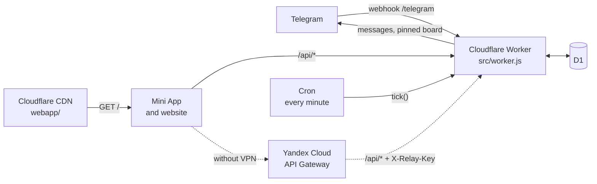

<div align="center">

[Русский](README.md) · **English**

# Techfloor

**A Telegram bot with a Mini App for the laundry room on the dorm's technical floor**

See which washers and dryers are free, who is using them and when they finish.<br/>
The bot reminds you to pick up your clothes, calls you when your turn in the queue comes, and keeps other people's laundry from sitting in a machine overnight.

[](https://workers.cloudflare.com/)
[-003B57?logo=sqlite&logoColor=white)](https://developers.cloudflare.com/d1/)
[](https://core.telegram.org/bots/webapps)
[](src/worker.js)
[](tests/)

<br/>

<table>
  <tr>
    <td align="center"></td>
    <td align="center"></td>
    <td align="center"></td>
  </tr>
  <tr>
    <td align="center"><sub>Machine board</sub></td>
    <td align="center"><sub>Taking a machine</sub></td>
    <td align="center"><sub>Dark theme</sub></td>
  </tr>
</table>

<sub>The app interface is in Russian. UI labels below are quoted in Russian with a translation.</sub>

</div>

---

## Features

| | |
|---|---|
| **Machine board** | Washer and dryer tiles colored by status: free, running, done, clothes without a program, moved clothes, held, booked, broken |
| **Take a machine in a few taps** | Time is taken from the machine's display. You can log someone else's load («Не мои, просто отмечаю», "Not mine, just logging it") or hide your name |
| **Queue and bookings** | A free machine is held for the next person in the queue or for a booking |
| **Reminders in DMs** | "Finishing soon", "done", then after 1, 3 and 5 h, with buttons "Clothes picked up", "In 15 min", "OK to move" |
| **Moved clothes** | Into another machine, onto the ironing board or into a bag, and the owner learns where to find them |
| **Undo a mistake** | Tapped the wrong machine or button? "Undo" at the bottom of the screen and in the machine's card puts everything back for 10 minutes |
| **Time correction** | If the machine recalculates its time, anyone can fix it. Limits stop harmful edits |
| **`/status` in DMs** | A laundry summary without opening the app |
| **Evening digest** | Opt-in: what is free and when it is quietest |
| **Hall of fame** | "Lightning", "Laundry Hero", "Night Owl", "Clean Week". No rankings in the chat and no perks |
| **Chat hints** | When someone writes "moved it" or "washer 3 done", the bot suggests marking it in the app |
| **Website** | The same app in a regular browser, signed in through the bot |
| **Protection** | Telegram signature checks, rate limits, automatic flood blocking, `/block` moderation, works only in its own chat |
| **Works without a VPN** | A loader and a Yandex Cloud gateway get around Cloudflare connections being cut |
| **Playroom** *(archived)* | Playroom booking calendar with open events and join requests |

<details>
<summary><b>All screenshots</b></summary>
<br/>

**Laundry**

<table>
  <tr>
    <td></td>
    <td></td>
    <td></td>
    <td></td>
  </tr>
  <tr>
    <td></td>
    <td></td>
    <td></td>
    <td></td>
  </tr>
  <tr>
    <td></td>
    <td></td>
    <td></td>
    <td></td>
  </tr>
  <tr>
    <td></td>
    <td></td>
    <td></td>
    <td></td>
  </tr>
</table>

**Playroom** *(archived; screenshots from when it was switched on)*

<table>
  <tr>
    <td></td>
    <td></td>
    <td></td>
    <td></td>
  </tr>
  <tr>
    <td></td>
    <td></td>
    <td></td>
    <td></td>
  </tr>
  <tr>
    <td></td>
    <td></td>
    <td></td>
    <td></td>
  </tr>
</table>

</details>

## Contents

- [How it works](#how-it-works)
- [Deploy](#deploy)
- [Configuration](#configuration)
- [Bot commands](#bot-commands)
- [Tests](#tests)
- [Features in detail](#features-in-detail)
- [Flood and abuse protection](#flood-and-abuse-protection)
- [Free plan and a custom domain](#free-plan-and-a-custom-domain)
- [Working without a VPN](#working-without-a-vpn)
- [Playroom (archived)](#playroom-archived)
- [Turning the laundry off](#turning-the-laundry-off)
- [Repository layout](#repository-layout)

---

## How it works



- **The whole server** lives in [`src/worker.js`](src/worker.js). It receives the Telegram webhook (`/telegram`), serves the app page ([`webapp/index.html`](webapp/index.html)) and handles its requests (`/api/state`, `/api/action`).
- **Users** are verified by the Telegram signature.
- **Cron** calls `tick()` once a minute: reminders, program ends, bookings, updating the pinned message. App requests call `tick()` only for their own chat and return right away when there is nothing to do, so polling the state costs three database queries.
- **Button presses** arrive through the same webhook as `callback_query`.
- **Database tables** create themselves, and settings are constants at the top of `src/worker.js`.
- **The app page is served as static assets.** `webapp/` is attached as `[assets]` in `wrangler.toml`, so `GET /` is served by the Cloudflare CDN without running the worker. These requests are free and do not count toward the daily limit (100,000 requests per day on the free plan). The worker only runs on `/api/*`, `/telegram`, `/setup` and unknown paths. Security headers for the page are in [`webapp/_headers`](webapp/_headers).

---

## Deploy

```bash
npm install
npx wrangler login

npx wrangler secret put BOT_TOKEN
npx wrangler secret put WEBHOOK_SECRET
npx wrangler secret put RELAY_KEY

npm run deploy
```

Then:

1. Open **`/setup?key=WEBHOOK_SECRET`** on the worker's address. Without this step Telegram will not deliver button presses. `/setup` registers the webhook and the command menu (including `/login`) and shows the Mini App URL.
2. In **@BotFather**: `/myapps` → your app → *Edit Web App URL* → the address from `/setup`: `https://…apigw.yandexcloud.net/start` (the gateway, see [Working without a VPN](#working-without-a-vpn)) or `https://…workers.dev/start` if there is no gateway.
3. Make the bot an **admin** of the group chat and send **`/board`** in the laundry topic.

> [!IMPORTANT]
> Secrets are set in Cloudflare only. Never commit them to the repository.

`npm run build` produces `dist/worker.js`: a single file with no imports, with the page and the loader embedded as strings.

---

## Configuration

**Secrets** (`npx wrangler secret put …`)

| Secret | Purpose |
|---|---|
| `BOT_TOKEN` | Bot token from @BotFather |
| `WEBHOOK_SECRET` | Verifies the Telegram webhook and is the key for `/setup` |
| `RELAY_KEY` | Yandex Cloud gateway key, see [Working without a VPN](#working-without-a-vpn) |

**Variables** (`[vars]` in [`wrangler.toml`](wrangler.toml))

| Variable | What it sets |
|---|---|
| `ALLOWED_CHATS` | Chat ids the bot works in, separated by commas or spaces (`-100…` for supergroups). Empty means no restriction |
| `OWNER_ID` | Who receives `/problem` reports |
| `SITE_URL` | Website address used in `/login` links (currently the gateway address) |
| `APP_SHORT_NAME` | Mini App short name for `t.me/…/<name>?startapp=…` links |
| `TZ_NAME` | Time zone, `Asia/Yekaterinburg` by default |
| `LAUNDRY` | `on` / `off`, the laundry |
| `PLAYROOM` | `on` / `off`, the playroom |
| `ROOM_REMIND_HOUR` | Hour of the evening question about playroom bookings |

Everything else (limits, timings, texts) is **constants at the top of [`src/worker.js`](src/worker.js)**: `WARN_MINUTES`, `MAX_MINUTES`, `NAG_HOURS`, `DIGEST_HOUR`, `LIMITS`, `HINTS` and others.

---

## Bot commands

| Command | Where | Who | What it does |
|---|---|---|---|
| `/start` | DM | everyone | What the bot can do |
| `/status` | DM | everyone | Laundry summary |
| `/login` | DM | everyone | Sign-in link for the website |
| `/problem` | DM | everyone | Report a problem to the owner |
| `/board` | group | admins | Pin the laundry board in this topic |
| `/playroom` | group | admins | Pin the playroom board *(when enabled)* |
| `/unpin` · `/unpin all` | group | admins | Unpin the bot in this topic or in the whole chat |
| `/block` · `/unblock` · `/blocked` | group | admins | Moderate access to the app |

Group commands are accepted only from chat admins, including anonymous ones.

---

## Tests

The tests in [`tests/`](tests/) run against a **fake Telegram**:

```bash
npm test            # or: python tests/all.py
```

Every run starts a fresh fake Telegram and worker, runs all suites and shuts both down (logs go to `tests/faketg.log` and `tests/server.log`). They are restarted each time because notification limits live in the worker's memory, and a second run would hit them.

To run a single suite, start `python tests/faketg.py` and `npm run test:server` in separate terminals. Suites can run one at a time and in any order:

| Suite | What it covers |
|---|---|
| `drive.py` | bookings, queue, time |
| `done.py` | program end, forgotten clothes |
| `room.py` | playroom |
| `auth.py` | initData signature, webhook secret, admin rights |
| `race.py` | concurrent requests and moving clothes into a chosen machine |
| `abuse.py` | limits, flood, request size, `/block` |
| `web.py` | website sign-in |
| `habits.py` | reminders with buttons, evening digest, badges, chat hints |
| `common.py` | shared harness: signed initData, webhook calls, running cron, database access |

<details>
<summary>Test environment notes</summary>

- The test worker keeps its database in the system temp folder (`techfloor-test`), outside OneDrive, and does not write request traces. Otherwise wrangler piles them up to hundreds of megabytes and the tests run several times slower.
- The playroom is enabled in [`tests/wrangler.toml`](tests/wrangler.toml) so the archived code keeps working.
- Rate limits are multiplied by `RATE_LIMIT_SCALE`, the digest hour is set by `DIGEST_HOUR`, and the fake Telegram address is set by `TELEGRAM_API`.

</details>

---

## Features in detail

### Time correction

A machine may recalculate its time mid-program, so a running machine has a **«Время на дисплее другое»** ("Display shows a different time") button. You pick the hours and minutes currently on the display with scroll wheels (hours 0–5, minutes 00–59), so you cannot set more than `MAX_MINUTES`. Anyone standing at the machine can fix it.

**Limits** (at the top of `src/worker.js`):
- each person corrects the time on a program **once**, and at most `TIMER_EDITS` (3) people per program;
- **shortening** is unlimited: a machine with a moisture sensor may finish much earlier;
- **extending** is allowed up to `TIMER_SHIFT_MINUTES` (60 min) past the originally entered end; the whole program is never longer than `MAX_MINUTES`;
- a finished program cannot be extended;
- limits are stored on the machine row and reset when a new program starts in it ("Take" or "Start program"), not by time.

**Exceptions.** Whoever started the program (or, if the machine was logged for someone else, whoever logged it) has no limit on the number of edits, so they can undo a wrong edit. Chat admins have no limits.

**Transparency.** Everyone sees that the time was corrected, who did it last and what the original time was. The clothes owner, whoever booked the machine after this program, and anyone whose booking is affected by the new time get a notification with the editor's name. The edit is written to `events` as `retime`. If more than `WARN_MINUTES` (15 min) remain after the edit, the "finishing soon" warning is sent again for the new time (the same message is edited in the group chat). Admins can shut out people who edit the time maliciously with `/block`.

### Notifications and the group chat

- Laundry notifications go to **DMs**.
- The group chat (the pinned-board topic) only gets the **"finishing soon"** warning, when the clothes owner is not logged or their DMs are closed.
- When the program ends, the bot **edits that same warning** to "done" instead of posting a new one. One program means one message in the chat; its id is stored in `machines.warn_msg`.
- If the owner's DMs are closed and there was no warning (a short program), the bot posts in the chat when the program ends.
- The bot **tags an owner with closed DMs and explains why**: «Стиралка 3 закончила. @username, у тебя закрыты личные сообщения — забери, пожалуйста, вещи.» ("Washer 3 is done. @username, your DMs are closed, please pick up your clothes."), and for "finishing soon": «…поэтому напоминаю здесь» ("…so I'm reminding you here"). The bot has no other way to reach them, and the clothes would just sit there. If the DMs open by the time the program ends, the message is edited to a plain "done" without the tag.
- **"Clothes picked up"** on a machine with leftover clothes ("done", clothes without a program, moved clothes) can be pressed by anyone, and the clothes owner is told who did it.
- **«Отменить»** ("Undo") shows for 10 minutes at the bottom of the app and in the affected machine's card after taking a machine, marking clothes without a program, "These are my clothes", freeing a machine, "Clothes picked up" and "Clothes moved". Undo puts the machines, queue, bookings and moved clothes back the way they were before the tap (table `undos`, one row per person). If someone else has changed the machine since, it can't be undone. Everyone the bot already messaged about that action (the clothes owner, whoever logged it, the next person in the queue) is told it was a mistake. The undone event in the log gets an `_undone` suffix and doesn't count toward badges.

### Pick-up reminders

The "done" message in DMs comes with the buttons **"Clothes picked up"**, **"In 15 min"** and **"OK to move"**.

- If the clothes are still there, the bot reminds the owner `NAG_HOURS` (**1, 3 and 5 h**) after the program ends. At 5 h it sends one of several joking lines, never the same as last time (the last one is stored in `meta` as `nag:<id>`). If several steps have passed at once (for example, the bot was down), only the last one is sent.
- **"In 15 min"** snoozes the reminder (`SNOOZE_MINUTES`) at most `SNOOZE_MAX` (2) times. Auto-release after `CLOTHES_HOURS` is not shifted.
- **"OK to move"** stops reminders to the owner, notifies whoever booked the machine after the program and the first person in the queue, and the machine shows «Хозяин разрешил переложить вещи» ("The owner allowed moving the clothes") in the app.
- The buttons are tied to the program (`started_at`), so they do nothing in old messages. Only the clothes owner can press them.
- At 5 h, if someone is waiting for the machine (queue or a booking after the program), the group chat gets **«Хозяин, отзовись»** ("Owner, please respond") without the owner's name (the same `warn_msg` message is edited, flag `called`). When the clothes are picked up or moved, it is edited to "free now" or "moved to …".
- The step, snooze time and flags are stored on the machine row: `nag`, `snooze_until`, `snoozes`, `movable`, `called`.

### Evening digest

**Opt-in only**: the "Evening digest" checkbox in the app or the «Да, присылай» ("Yes, send it") button. The bot offers the digest once, after a person presses "Clothes picked up" on their own machine.

- At `DIGEST_HOUR` (20:00) the bot sends a DM with which machines are free, which one frees up first, when the usual rush is (`PEAK_HOURS`), and that `QUIET_HOURS` (2 to 10) are the calmest.
- Only people who opened the app within the last `DIGEST_ACTIVE_DAYS` (14) days and are not blocked receive it.
- At most once a day (`people.digest_day`) and at most `DIGEST_BATCH` messages per cron run, to stay under the free plan's subrequest limit.
- The digest has an "Unsubscribe" button. It contains no badges or rankings.

### Badges and the hall of fame

Visible **only in the app** (the "Hall of fame" card). The bot never mentions them in DMs or in the chat, and they give no perks. Everything is computed from the `events` table.

| Badge | Weekly condition |
|---|---|
| **Lightning** («Молния») | Pick up your clothes within the first `LIGHTNING_MINUTES` (10) minutes after the program ends, 3 times |
| **Laundry Hero** («Герой прачечной») | 2 logs of someone else's load ("Not mine, just logging it") or of clothes without a program. At most one per machine per day and at most `HERO_WEEK_CAP` (5) counted. Logs undone by their author or an admin within `HERO_REVERT_MINUTES` (30) minutes do not count |
| **Night Owl** («Сова») | 2 loads started between 2 and 10 a.m. |
| **Clean Week** («Чистая неделя») | At least 2 loads, all picked up within an hour |

- Weeks start on Monday. On Monday after 1 a.m. the cron writes last week's badges to the `badges` table (flag `badges_week` in `meta`).
- The hall of fame shows **last week's top 3** for each badge except "Clean Week", with shared places on ties.
- Your own progress for the current week is computed when you open the card (`GET /api/honor`).
- People who turned on "Hide my name" appear as «Аноним» ("Anonymous").

### Status in DMs

If you don't feel like opening the app, send **`/status`** to the bot in DMs and get a summary:

- how many washers and dryers are free, and which ones;
- which are running and until when (if none are free, when the nearest one finishes);
- which have clothes in them, which are held for the queue or a booking, which are broken, and how many people are in the queue;
- a **«Твоё»** ("Yours") block: your machines with time left, your place in the queue, your bookings and your moved clothes (on the ironing board, in a bag or in some machine).

The summary contains no other people's names. The chat is detected automatically: the bot picks the chat with a pinned laundry board that the person belongs to (if there are several, the one where they last opened the app). Non-members are told the laundry wasn't found, and people who are blocked are told why. Below the summary there is an "Open laundry" button; send `/status` again for a fresh one. In a group, `/status` is simply deleted. While the laundry is off (`LAUNDRY = "off"`), the command does not exist.

### Website

The same app opens in a regular browser at the worker's address (`https://…workers.dev/` or a custom domain): the same `webapp/index.html` page and the same `/api/state` and `/api/action`.

**Sign-in only through the bot:**
1. `/login` in DMs (or the "Get a link in Telegram" button on the site, which opens the bot with `/start login`) sends a button with a `/#login=…` link.
2. The link is single-use and lives for `LOGIN_MINUTES` (10 min). The token comes after `#`, so it never reaches the server when Telegram or a browser loads a link preview.
3. The page exchanges the token via `POST /api/login` for a `session` cookie (HttpOnly, SameSite=Strict, Path=/api) valid for `SESSION_DAYS` (30 days).

**Security:**
- The `sessions` table stores only SHA-256 hashes of tokens.
- Sign-in from another site's page (the Origin header) is rejected. Bad links and cookies count toward the same per-IP error limit as bad initData.
- Chat membership, blocks and limits are checked on every request, just like in Telegram, so `/block` also locks someone out of the site.
- The "Sign out" button at the bottom of the page deletes the session (`POST /api/logout`).
- If a request carries both initData and a cookie, initData wins.

The chat is chosen the same way as for `/status`. The link is built from the address Telegram sends the webhook to; set a different site address with the `SITE_URL` variable. Without a Telegram theme the site follows the system light or dark theme. After deploying, open `/setup?key=WEBHOOK_SECRET` so `/login` appears in the bot's command menu.

### Problem reports

- In DMs, `/problem text`, or `/problem` followed by an answer to the bot's question (a screenshot is fine), is forwarded to the DMs of the user whose id is `OWNER_ID`, together with the sender's name and id.
- The owner has to press "Start" with the bot first, otherwise Telegram won't let the bot message them. Without `OWNER_ID` the bot replies that there is no one to forward to.
- Accepted: text, photos, JPG, PNG and WebP images, PDF and MP4 video up to 20 MB (`PROBLEM_FILES`, `PROBLEM_FILE_MB`). For any other format or a file that is too large, the bot explains what's wrong and asks again. These attempts do not use up the problem-report limit.
- **Owner replies:** reply to the «Проблема от …» ("Problem from …") message. The bot forwards the reply (a screenshot is fine) and answers «Отправлено.» ("Sent.") or «Не доставлено» ("Not delivered"). The person can reply to the reply, and it reaches the owner again as «Проблема от …». Only the `OWNER_ID` user can reply this way.

### Chat hints

When someone writes in the group chat instead of using the app, the bot replies with a hint and an **«Отметить в приложении»** ("Mark it in the app") button. The rules are in `HINTS` in `src/worker.js`.

| Hint | Triggers on | Examples |
|---|---|---|
| **«Переложил чужие вещи?»** ("Moved someone's clothes?") | Text or a photo caption with a word starting with «перелож», «перекин», «вытащ», «вынул» ("moved", "took out"; `MOVE_WORDS`), in any gender or number | Yes: «переложила», «перекинули», «вещи переложены» |
| **«Стирка закончилась?»** ("Load done?") | A short message (up to 6 words, no "?") with «все»/«всё» ("done") or «закончил…»/«постирал…» ("finished…"; `DONE_WORD`), where all other words are machine numbers, "washer", "dryer", "machine", "wash", "dry" in any form, or fillers from `DONE_FILLER` («уже», «тоже», «у меня», «моя»…) | Yes: «5 всё», «стиралка 3 закончила», «у меня постиралось»<br/>No: «все заняты» ("all busy"), «всё?», «порошок закончился» ("out of detergent") |

- At most one hint of each kind per chat every 10 minutes (the `hint` limit in `LIMITS`).
- The button opens the app with a `startapp=<chat>_<kind><message id>` link (`m` means "moved", `f` means "finished"). With such a link the app shows a card on top explaining what to press. The card disappears after the right action or on "Hide".
- **The hint is deleted** when any chat member opens the app through its button. Telegram does not tell the bot about link-button presses, so the first app request with that link serves as the signal.
- Hint ids are stored in the `hints` table and dropped after `HINT_HOURS` (48 h). After that Telegram no longer lets the bot delete its own messages, so a hint nobody opened stays in the chat.
- The bot reacts only to new messages: old and edited ones are not checked.
- Only messages in the topic where the laundry board sits are checked. In a forum chat, messages in other topics are ignored.

> [!NOTE]
> To see regular group messages, the bot must be a chat admin (it already is, for pinning) or have privacy mode turned off in @BotFather.

---

## Flood and abuse protection

**Before the database.** Requests without a valid Telegram signature are rejected before touching the database: bad initData, a bad webhook secret or a bad `/setup` key cost only an HMAC check (constant-time comparison). After 30 such errors in 10 minutes from one IP, `/setup` and the webhook are closed for that IP.

**Sizes.** Request bodies are capped at 8 KB for the app and 1 MB for the webhook; initData at 4 KB.

**Per-user limits** are in `LIMITS`:

| What | Limit |
|---|---|
| State requests | 60 per minute |
| Actions | 20 per minute |
| Flooding past the limit | 20 rejections in 10 minutes → 30-minute block (`blocks` table, applies across all worker instances) |
| Notifications from one person to another | 5 per hour (extra ones aren't sent, the action itself still goes through) |
| DM commands | 5 per minute |
| Problem reports | 5 per hour |

**Moderation** (chat admins only, including anonymous ones):
- `/block` as a reply to a message, `/block @username` or `/block id`, optionally with a duration (`30m`, `12h`, `3d`). Removes access to the app in this chat and clears the person's queue spots and bookings.
- `/unblock` restores access, `/blocked` lists blocked people.
- `/unpin` removes the bot's pinned messages from the topic where the command was sent, `/unpin all` from the whole chat. The pin is no longer updated, and if none are left in the chat, the app won't open until an admin sends `/board` again.

**Own chat only.** The bot works only in the chats listed in `ALLOWED_CHATS`.
- If the bot is added to any other chat, it says it only works in the dorm chat and leaves immediately. It also leaves in response to commands from such a chat, and the app won't open from a link with a foreign chat id.
- Every such attempt is written to `events` with the action `foreign` (who added the bot, chat title).
- `/setup` removes the bot's pins in foreign chats, leaves them and shows the list of allowed chats. If `ALLOWED_CHATS` is empty there is no restriction, and `/setup` shows the ids of chats that currently have a pin.
- You can also forbid adding the bot to groups in @BotFather (*Bot Settings → Allow Groups? → Turn groups off*). The bot does not leave chats it is already in.

> [!WARNING]
> A regular group gets a new id when it becomes a supergroup. Add the new id to `ALLOWED_CHATS` in advance, otherwise the bot will leave it.

Limit counters live in each worker instance's memory, so protection against volumetric DDoS comes from Cloudflare's network itself.

---

## Free plan and a custom domain

To keep a flood on `/api/*` from eating the daily limit, you need a custom domain (you can get a free one at nic.eu.org) and a free Rate limiting rule:

1. Attach the worker to the domain: add to `wrangler.toml`
   ```toml
   routes = [{ pattern = "bot.example.org", custom_domain = true }]
   ```
   and deploy.
2. In the Cloudflare dashboard: *Security → WAF → Rate limiting rules* → a rule with the expression `URI Path contains /api/`, a threshold of about 20 requests per 10 seconds per IP, and the *Block* action.

The free plan includes one such rule (fields limited to Path and Verified Bot, a 10-second window, counted per IP). Cloudflare's automatic network-level DDoS protection works on every plan.

> [!CAUTION]
> Rate limiting rules do not apply to `*.workers.dev`, only to a custom domain. Turn off `workers.dev` after switching, or the flood will go through it.

---

## Working without a VPN

**The problem.** Russian ISPs cut connections to Cloudflare after the first ~16 KB, and the Mini App window does not use Telegram's proxy. So without a VPN, the page on `*.workers.dev` does not load.

**A two-layer fix:**

1. **Yandex Cloud API Gateway** (free up to 100,000 requests a month) sits in front of the worker: it serves `/` and `/start` and forwards `/api/*` to the worker. The Telegram webhook, cron and the database stay on Cloudflare.
2. **The `/start` loader** ([`src/start.html`](src/start.html), ~3 KB). Telegram opens it from the gateway: with some ISPs Cloudflare does not answer at all without a VPN, not even for a small page. The loader fetches the app page from the address it was opened from and from `SITE_URL` at the same time, shows whichever arrives in full first, and the app then sends all `/api/*` requests to that same place.

| Network | Where the app loads from |
|---|---|
| No VPN | gateway |
| With a VPN | gateway |
| With a VPN that can't reach Yandex (Estonian ones, for example) | does not open, turn the VPN off |

**Details:**
- The Mini App URL for BotFather (*/myapps → your app → Edit Web App URL*) is `https://…apigw.yandexcloud.net/start`; `/setup` shows it. With the old `https://…workers.dev/start` address the app does not open where Cloudflare is unreachable altogether.
- The gateway address is stored in `SITE_URL`. `/login` links point to it (the site only talks to its own address because sign-in relies on a cookie), and the loader fetches the app page from it.
- Requests from the worker's page to the gateway come from a different origin, so the gateway spec enables CORS for the worker's address.
- To the worker, every user appears to come from the gateway's IP, so the gateway adds an `X-Relay-Key` header with the `RELAY_KEY` secret. Only with the correct key does the worker take the visitor's IP from the last address in `X-Real-Remote-Address`; the gateway appends it itself, so it can't be forged. Without this, 30 bad requests from one person would lock everyone out.
- Website sign-in accepts both the worker's Origin and `SITE_URL`. The old `workers.dev` address keeps working with a VPN.

<details>
<summary><b>Gateway spec</b> (put in your own <code>RELAY_KEY</code>)</summary>

```yaml
openapi: 3.0.0
info:
  title: techfloor
  version: 1.0.0
x-yc-apigateway:
  cors:
    origin: https://techfloor.lanhua1122333.workers.dev
    methods: [GET, POST]
    allowedHeaders: [Content-Type, X-Init-Data]
    maxAge: 600
paths:
  /:
    get:
      x-yc-apigateway-integration:
        type: http
        url: https://techfloor.lanhua1122333.workers.dev/
  /start:
    get:
      x-yc-apigateway-integration:
        type: http
        url: https://techfloor.lanhua1122333.workers.dev/start
  /api/{path+}:
    x-yc-apigateway-any-method:
      parameters:
        - name: path
          in: path
          required: true
          schema:
            type: string
      x-yc-apigateway-integration:
        type: http
        url: https://techfloor.lanhua1122333.workers.dev/api/{path}
        headers:
          '*': '*'
          Host: techfloor.lanhua1122333.workers.dev
          X-Relay-Key: RELAY_KEY
        timeouts:
          connect: 5
          read: 25
```

`Host` must be set explicitly: with `'*': '*'` the gateway otherwise passes its own address, and Cloudflare drops the TLS connection.

</details>

---

## Playroom (archived)

The playroom booking calendar is currently **off**: the code stays in `src/worker.js` and `webapp/index.html`, but it is hidden in production.

**To turn it on:** set `PLAYROOM = "on"` in `[vars]` in `wrangler.toml` (currently `"off"`; without the variable it is also off), then `npm run deploy` and `/setup?key=WEBHOOK_SECRET` to restore the bot description and the `/playroom` command in the menu.

**While the playroom is off:**
- there is no tab or calendar in the app;
- `/playroom` and buttons in old DMs are ignored, `room_*` actions are rejected;
- cron sends no booking reminders and does not update the playroom pin;
- `/start`, the bot description and the command menu mention only the laundry;
- the `pboards`, `room_bookings`, `room_joins` and `room_requests` tables and their data are left untouched;
- the old playroom pin in the chat stays as it is. Remove it with `/unpin` in the playroom topic; its button opens the laundry.

<details>
<summary><b>How the playroom works</b></summary>
<br/>

- **Bookings.** A booking is either private (simply taken) or an **open event**: it is announced in the chat, any member can press "I'm coming", and the app and the pin show how many people are going.
- **Spots.** The organizer can limit the number of spots (1 to 100, not counting themselves) or leave it unlimited. When spots run out, "I'm coming" turns into "No spots left".
- **Editing.** You can edit your booking (time, reason, open or private, number of spots). The edit is announced in the chat, people who signed up are notified of a reschedule, and if the event becomes private their sign-ups are removed. Before booking or editing, the app shows an «Всё верно?» ("Is this right?") summary.
- **Reminders.** In the evening (`ROOM_REMIND_HOUR`) cron asks in DMs about tomorrow's bookings with «Да, бронь нужна» / «Нет, отменить бронь» ("Yes, keep it" / "No, cancel it") and reminds half an hour before the start. People signed up for an open event (`room_joins` table) also get a reminder half an hour before, with an "I won't come" button, and a cancellation message if the event is cancelled.
- **Join requests.** You can ask to join a private booking with the "Ask to join" button (optionally with a short message). The request (`room_requests` table) reaches the organizer in DMs with "Accept" / "Decline" buttons; if their DMs are closed, the bot mentions them in the playroom topic. The organizer also sees requests in the app in the «Просятся к тебе» ("Asking to join you") block.
  - An accepted guest is added to `room_joins` and gets the same reminders and reschedule and cancellation messages as event sign-ups.
  - After a decline you can't ask to join the same booking again, and a pending request can be withdrawn.
  - The organizer sees the real name of the person asking, even if it is hidden.
  - If a private booking becomes an open event, requests are cleared and the people who asked are told they can just press "I'm coming".
  - At most 10 requests per hour per person.
- **Limits.** At most 3 active bookings per person and 6 bookings or cancellations per 10 minutes (admins are exempt).
- An admin pins the playroom board with `/playroom` in the right topic. `/block` also removes future playroom bookings.

</details>

---

## Turning the laundry off

The laundry is turned off the same way: `LAUNDRY = "off"` in `[vars]` in `wrangler.toml` (currently `"on"`; without the variable it is on), then `npm run deploy` and `/setup?key=WEBHOOK_SECRET` to update the bot description and the command menu.

**While the laundry is off:**
- there is no laundry tab; the app opens the playroom right away;
- `/board` is ignored and laundry actions are rejected;
- cron does not process machines, the queue or bookings and does not update the laundry pin;
- `/start`, the bot description and the command menu mention only the playroom;
- laundry tables and their data are left untouched;
- the old laundry pin in the chat stays as it is. Remove it with `/unpin` in the laundry topic; its button opens the playroom.

If both the laundry and the playroom are off, the app replies «Приложение сейчас выключено» ("The app is currently off").

---

## Repository layout

```
techfloor-bot/
├── src/
│   ├── worker.js        the whole server: webhook, API, cron, database
│   └── start.html       Mini App loader (~3 KB)
├── webapp/
│   ├── index.html       the Mini App and website
│   └── _headers         security headers for static assets
├── tests/               fake Telegram and test suites
├── assets/              screenshots
├── build.py             builds dist/worker.js as a single file
├── wrangler.toml        Cloudflare config
└── ideas.md             ideas for the future
```

---

<div align="center">

Plans for what comes next are in [**ideas.md**](ideas.md)

<sub>Made for the people of the dorm, so nobody has to hunt for their wet socks again</sub>

</div>
